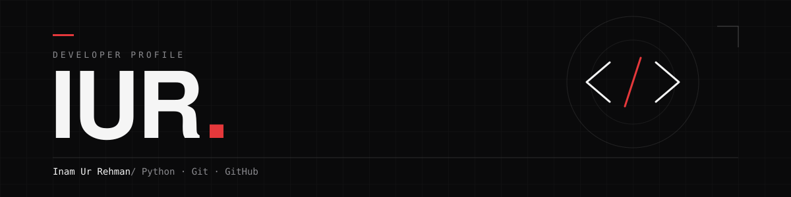

 

**Turning loose ideas into clean, working code.**

Programming, software development, and creative problem-solving. 
Python, Git, and GitHub are where I focus.

 

`01 — STACK`

<!--   -->

  

`02 — DASHBOARD`
<table>
  <tr>
    <td align="center" valign="top">
      
    </td>
    <td align="center" valign="top">
      
    </td>
  </tr>
</table>

 

`03 — SELECTED WORK`

<table width="100%">
  <tr>
    <td width="64" align="center"><code>01</code></td>
    <td>
      <a href="https://github.com/inamurrehman-1919/smart_todo_app"><b>Smart To-Do App for Business Owners</b></a> 
      A smart and user-friendly task management app designed to help business owners organize tasks, prioritize work, and boost productivity efficiently.
    </td>
  </tr>
  <tr>
    <td width="64" align="center"><code>02</code></td>
    <td>
      <a href="https://github.com/inamurrehman-1919/PROJECT_TWO_REPO"><b>Project Two</b></a> 
      One concise sentence describing what this project does and why it exists.
    </td>
  </tr>
  <tr>
    <td width="64" align="center"><code>03</code></td>
    <td>
      <a href="https://github.com/inamurrehman-1919/PROJECT_THREE_REPO"><b>Project Three</b></a> 
      One concise sentence describing what this project does and why it exists.
    </td>
  </tr>
</table>

 

  <a href="https://github.com/YOUR_GITHUB_USERNAME">GitHub</a>
  &nbsp;·&nbsp; <a href="YOUR_LINKEDIN_URL">LinkedIn</a>
  &nbsp;·&nbsp; <a href="mailto:YOUR_EMAIL">Email</a>

